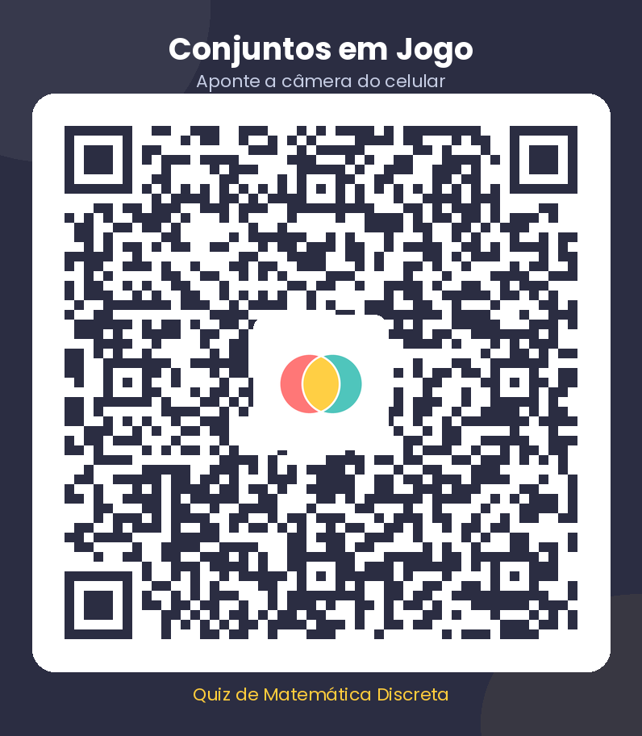

# Conjuntos em Jogo

Quiz educativo de **Matemática Discreta** para o Ensino Médio, disponível em **duas versões**: uma feita em **Python + Pygame** para computador e uma **versão web responsiva** que abre no navegador do celular (inclusive instalável como aplicativo). O jogo trabalha a definição de conjuntos, a pertinência entre elemento e conjunto, os subconjuntos, a união, a interseção e o complemento, sempre apoiado por diagramas de Venn e por explicações depois de cada resposta.

O projeto foi pensado para o Trabalho Aplicado – AV2 e pode ser executado localmente ou publicado no GitHub.


## Sobre o jogo

São **12 perguntas de múltipla escolha**, com **30 segundos** para responder cada uma. O jogador escolhe entre quatro alternativas e, em seguida, recebe a correção com uma explicação curta do conceito. Ao final, o jogo mostra a pontuação, o aproveitamento, a melhor sequência de acertos, o tempo total e os temas que merecem revisão.

O visual foi construído com uma identidade própria: fundo escuro, cartões claros, cores de apoio e diagramas de Venn desenhados especificamente para cada questão.

| Quiz | Feedback |
| --- | --- |
|  |  |

| Instruções | Resultado |
| --- | --- |
|  |  |

## Conteúdo abordado

- Definição de conjunto e relação de pertinência (`∈` e `∉`)
- Subconjuntos (`⊂`), incluindo o conjunto vazio
- União (`∪`) e interseção (`∩`)
- Complemento (`Aᶜ`) em relação ao conjunto universo
- Conjuntos disjuntos
- Leitura de diagramas de Venn
- Princípio da inclusão-exclusão para contagem de elementos

## Como jogar

| Ação | Mouse | Teclado |
| --- | --- | --- |
| Escolher alternativa | clique na opção | `1` a `4` ou `A` a `D` |
| Avançar após a correção | botão **Continuar** | `Enter` ou `Espaço` |
| Voltar ao menu | botão de seta | `Esc` |
| Tela cheia | — | `F11` |

### Pontuação

- **+10 pontos** por resposta correta;
- **+1 ponto** por segundo restante no cronômetro;
- **+10 pontos** extras a cada três acertos consecutivos.

O recorde fica salvo no arquivo `recorde.json`, criado automaticamente na primeira partida. Esse arquivo não deve ser enviado ao GitHub (já está no `.gitignore`). Na versão web, o recorde e a preferência de som ficam no `localStorage` do navegador.

## Como executar

Requisitos: **Python 3.9 ou superior** e o pacote **pygame-ce** (compatível com `import pygame`).

```bash
# 1. entre na pasta do projeto
cd jogo_conjuntos

# 2. crie e ative um ambiente virtual (opcional, mas recomendado)
python -m venv .venv
source .venv/bin/activate        # Linux/macOS
# .venv\Scripts\activate         # Windows

# 3. instale a dependência
pip install -r requirements.txt

# 4. execute
python main.py
```

Também é possível usar os atalhos:

```bash
./executar.sh        # Linux/macOS
executar.bat         # Windows
```

Se aparecer algum erro relacionado a áudio, o jogo continua funcionando normalmente, apenas sem os efeitos sonoros.

## Executando no OneCompiler

O projeto também tem uma versão em **arquivo único**, pensada para colar direto no editor online:

1. Abra [onecompiler.com/python](https://onecompiler.com/python);
2. apague o conteúdo do arquivo `main.py` do editor;
3. copie todo o conteúdo de [`onecompiler/main.py`](onecompiler/main.py) deste repositório e cole no editor;
4. clique em **Run**.

Essa versão não depende de imagens, fontes ou sons externos: os diagramas e os cartões são desenhados com as próprias funções do Pygame, e as fontes vêm do sistema. O conteúdo das questões é o mesmo da versão completa.

> A versão completa, com os assets em alta resolução, é a recomendada para apresentação e para o GitHub.

## Versão web (celular e tablet)

A pasta [`web/`](web) traz o mesmo quiz em **HTML, CSS e JavaScript puros**, sem instalar nada. Ela foi pensada para o celular: botões grandes, áreas de toque confortáveis, layout que se adapta a telas pequenas, vibração nas respostas, som, recorde salvo no próprio aparelho e funcionamento **offline** depois do primeiro acesso.

| Menu no celular | Quiz no celular |
| --- | --- |
|  |  |

| Diagrama no celular | Resultado no celular |
| --- | --- |
|  |  |

### Acesso rápido

Aponte a câmera do celular para o QR Code abaixo (prévia publicada, link temporário):



Depois de publicar o projeto, gere o QR Code definitivo com o seu link:

```bash
python ferramentas/gerar_qrcode.py https://seu-link-aqui
```

### Abrir no celular

**Opção 1 — publicar (recomendado).** Suba o conteúdo da pasta `web/` em qualquer hospedagem estática (GitHub Pages, Netlify, Vercel). No GitHub Pages, por exemplo, basta ativar o Pages apontando para a pasta `web`; o link gerado abre no celular de qualquer lugar.

**Opção 2 — mesma rede Wi-Fi.** No computador, dentro da pasta `web/`, execute:

```bash
python -m http.server 8080
```

Descubra o IP local da máquina (`ip addr` no Linux, `ipconfig` no Windows) e abra no celular:

```text
http://SEU_IP:8080
```

> O service worker e a instalação como app só funcionam em `https://` ou em `localhost`. Em `http://` na rede local o jogo funciona normalmente, mas sem cache offline.

### Instalar como aplicativo

Ao abrir a versão publicada no celular, o navegador oferece **“Adicionar à tela inicial”** (Chrome/Android) ou **“Adicionar à Tela de Início”** (Safari/iOS). O jogo passa a abrir em tela cheia, com ícone próprio, como um app. Há também um botão **Instalar app** no menu quando o navegador permite.

### Recursos exclusivos da versão web

- Layout **mobile-first** com suporte a celular na vertical e na horizontal;
- Toque, teclado (`1`–`4`, `A`–`D`, `Enter`) e leitor de tela;
- Vibração curta ao acertar e ao errar (quando o aparelho suporta);
- Botão **Compartilhar** no resultado (share nativo ou cópia do texto);
- Recorde e preferência de som salvos no `localStorage`;
- Cache offline via service worker.

### Publicar no GitHub Pages

1. Envie o projeto para o GitHub;
2. em **Settings → Pages**, escolha a branch `main` e a pasta `/web`;
3. aguarde alguns minutos e acesse `https://SEU_USUARIO.github.io/SEU_REPOSITORIO/`.

Como os caminhos são relativos, o jogo funciona tanto na raiz do domínio quanto em subpastas.

## Estrutura do projeto

```text
jogo_conjuntos/
├── main.py                  # inicialização, navegação e laço principal
├── jogo/
│   ├── config.py            # cores, medidas, fontes e caminhos
│   ├── perguntas.py         # banco de questões, alternativas e explicações
│   ├── telas.py             # menu, instruções, quiz e resultado
│   └── ui.py                # botões, cartões, textos e barras
├── assets/
│   ├── fonts/               # Poppins e DejaVu Sans
│   ├── images/              # logotipo, fundo e diagramas de Venn
│   └── sounds/              # efeitos sonoros sintetizados
├── ferramentas/
│   ├── gerar_assets.py      # recria as imagens a partir do código
│   └── gerar_sons.py        # recria os efeitos sonoros
├── onecompiler/
│   └── main.py              # versão em arquivo único para uso online
├── web/                     # versão para navegador (celular, tablet e desktop)
│   ├── index.html           # todas as telas em uma página
│   ├── css/estilo.css       # layout mobile-first e responsivo
│   ├── js/perguntas.js      # banco de questões
│   ├── js/jogo.js           # lógica do quiz, placar e recorde
│   ├── assets/              # imagens, sons e fontes usadas na web
│   ├── icons/               # ícones do aplicativo instalável
│   ├── manifest.json        # configuração do PWA
│   └── sw.js                # cache offline
├── screenshots/             # capturas usadas neste README
├── requirements.txt
├── executar.sh
├── executar.bat
├── LICENSE
└── README.md
```

## Recriando os assets

As imagens e os sons do jogo são gerados por scripts próprios, o que facilita ajustar cores, textos e formatos sem depender de arquivos externos.

```bash
pip install -r requirements-dev.txt
python ferramentas/gerar_assets.py
python ferramentas/gerar_sons.py
```

## Equipe

| Integrante | Responsabilidade |
| --- | --- |
| _preencher_ | _preencher_ |
| _preencher_ | _preencher_ |
| _preencher_ | _preencher_ |
| _preencher_ | _preencher_ |
| _preencher_ | _preencher_ |

## Créditos

- **Poppins** — fonte criada por Indian Type Foundry, distribuída sob a SIL Open Font License.
- **DejaVu Sans** — fonte livre usada para os símbolos matemáticos (`∈`, `∪`, `∩`, `⊂`, `∅`).
- Efeitos sonoros sintetizados com a biblioteca padrão `wave`, sem samples de terceiros.

## Licença

Este projeto está disponível sob a licença MIT. Consulte o arquivo [LICENSE](LICENSE).
